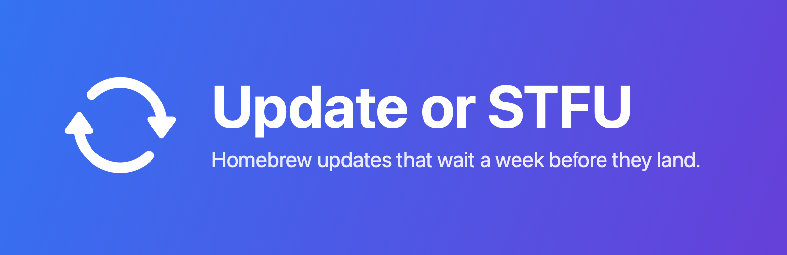
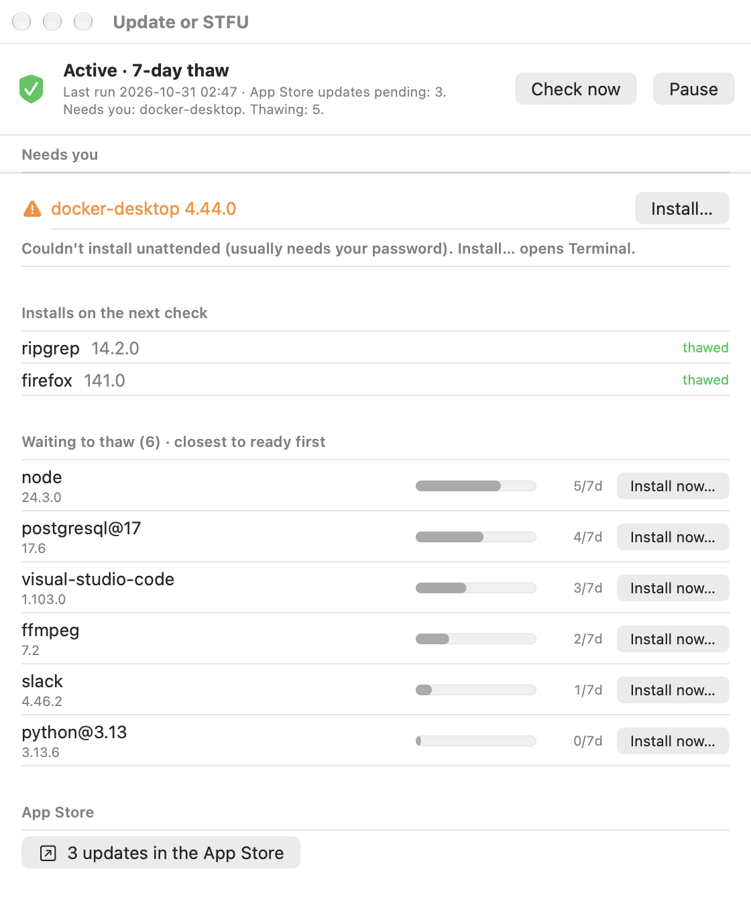
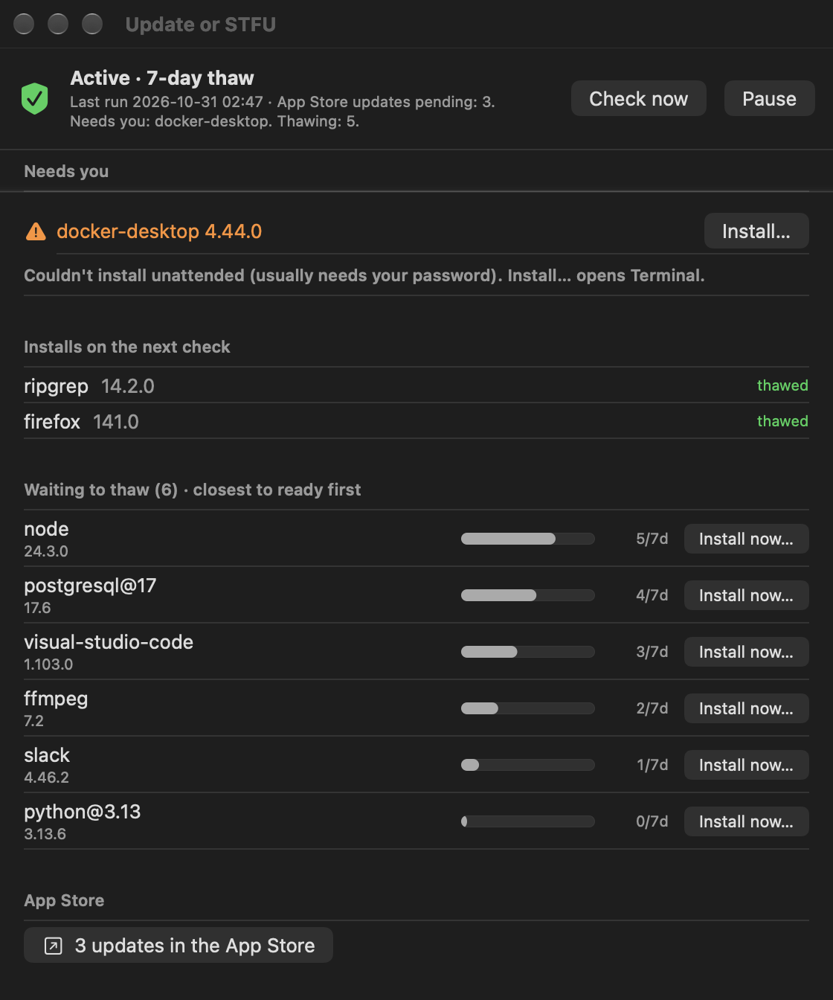
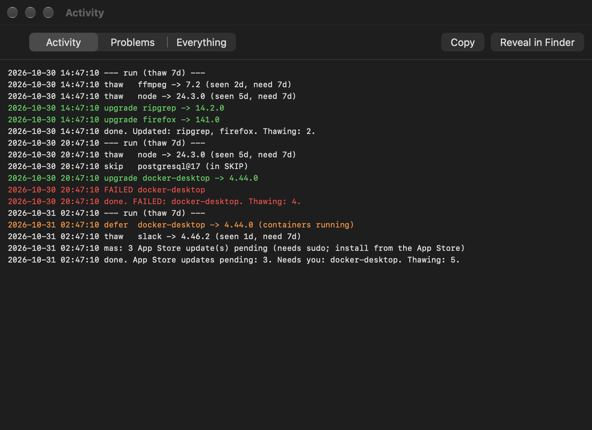
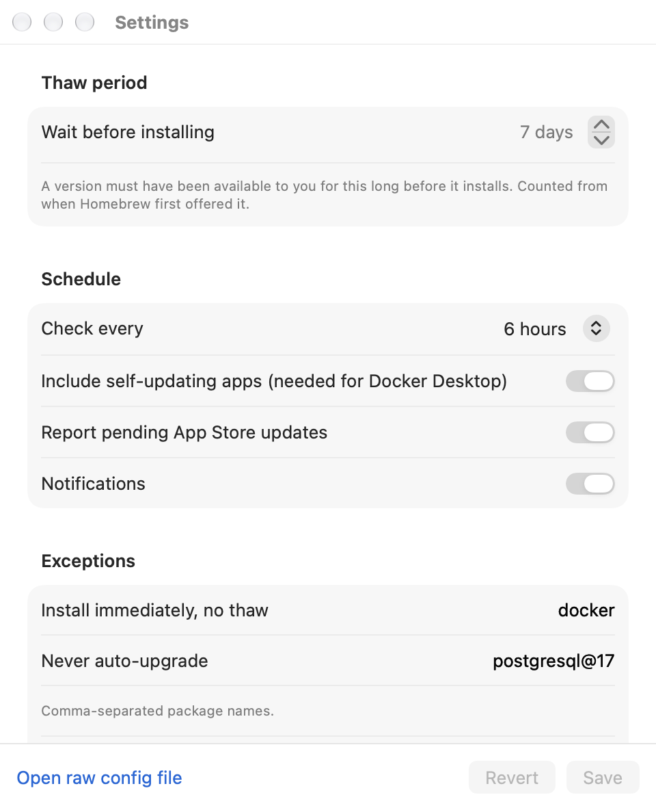
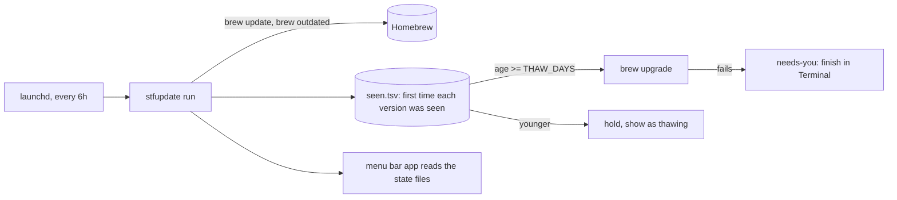

# STFUpdate

[](https://github.com/pmsosa/STFUpdate/actions)
[](https://github.com/pmsosa/STFUpdate/releases)
[](LICENSE)
[](#install)

Automatic Homebrew updates with a **thaw period**: a new version is installed only after Homebrew has
offered it for a number of days (7 by default). If it was a bad or compromised release, there's a good
chance it has been pulled or fixed before it ever reaches your machine.

It runs from launchd, lives in the menu bar, and tells you when something needs you. Zero dependencies:
a zsh script, launchd, and a small native SwiftUI app.

## See it

These windows are rendered from made-up demo data (`tools/screenshots.sh`), not from a real machine.

<table>
<tr>
<td width="50%" valign="top">
<br>
<sub>Status</sub>
<h3>What's waiting, and for how long</h3>
Packages that have thawed install on the next check. The rest show a progress bar toward the thaw period, closest to ready first. <i>Install now…</i> skips the wait for one package.
</td>
<td width="50%" valign="top">
<br>
<sub>Dark mode</sub>
<h3>Native, follows the system</h3>
A plain SwiftUI window. Anything that failed to install unattended (usually it needs your password) is pinned at the top, and one click opens Terminal to finish it.
</td>
</tr>
<tr>
<td width="50%" valign="top">
<br>
<sub>Activity</sub>
<h3>A readable log</h3>
Every decision is logged: what was held, what was upgraded, what was skipped or deferred, and what failed. Filter to just the problems.
</td>
<td width="50%" valign="top">
<br>
<sub>Settings</sub>
<h3>Four knobs that matter</h3>
Thaw days, how often to check, which packages install immediately (Docker by default), and which are never touched.
</td>
</tr>
</table>



## Why a thaw period?

Updating on release day means you're the first to find out about a broken build, a bad cask, or a
hijacked package. Never updating means running stale software. Waiting a week gets you most of the
benefit of both.

## Install

**Download:** grab the DMG from [Releases](../../releases), drag the app to Applications, open it, and
click *Set Up*. It is signed with a Developer ID and notarized by Apple, so it opens without warnings.
Turn on *Open STFUpdate at login* in Settings if you want it running after a restart.

**From source** (needs the Xcode Command Line Tools):

```sh
git clone https://github.com/pmsosa/STFUpdate && cd STFUpdate
./stfupdate install       # scheduler only, no app
./stfupdate app-install   # scheduler + menu bar app
```

Requires macOS 13+ and [Homebrew](https://brew.sh).

## What it does

Every 6 hours it runs `brew update`, then looks at `brew outdated` (formulae and casks):

- **Seen for at least `THAW_DAYS`:** upgraded.
- **Newer than that:** left alone, and shown as "waiting to thaw". The clock starts the first time
  *this tool* sees a version, not at the upstream release date, and a still-newer version restarts it.
- **`NO_THAW` packages** (Docker by default) install immediately. Docker is deferred while containers
  are running.
- **`SKIP` packages** are never touched.
- **Upgrade fails** (usually because it needs your password): it is not retried. It shows up under
  *Needs you*, and the menu opens Terminal to finish it.
- **Mac App Store updates** are only counted (needs [`mas`](https://github.com/mas-cli/mas)); installing them needs sudo.

It runs `brew upgrade` unattended, `brew cleanup --prune=30` after upgrades, and includes casks that
self-update (`--greedy`). Turn that off with `GREEDY_CASKS=0`.

## Configuration

Settings are in the app (Settings…) or in `~/.config/stfupdate/config`:

```sh
THAW_DAYS=7
CHECK_EVERY_HOURS=6
NO_THAW=(docker docker-desktop)
SKIP=()
DOCKER_SKIP_IF_RUNNING=1
GREEDY_CASKS=1
USE_MAS=1
NOTIFY=1
```

## Command line

```
stfupdate run [--dry-run]   check and upgrade now
stfupdate status            pending updates and their age
stfupdate now KIND NAME     upgrade one package immediately (kind: formula | cask)
stfupdate clear KIND NAME   forget a pending entry
stfupdate uninstall         remove agents, app and installed script
```

Try `stfupdate run --dry-run` first to see what it would do.

## Files

| Path | What |
| --- | --- |
| `~/.local/bin/stfupdate` | installed copy of the script |
| `~/.config/stfupdate/config` | settings |
| `~/.local/state/stfupdate/` | seen versions, needs-you list, log |
| `~/Library/LaunchAgents/com.konukoii.stfupdate*.plist` | scheduler and app login agents |

Uninstall removes the agents, app and script, and leaves the config and state.

## Development

```sh
tests/run.sh      # thaw logic, against a fake brew and a throwaway $HOME
./build-dmg.sh    # universal app + DMG in dist/ (--sign for Developer ID + notarization)
tools/screenshots.sh   # regenerate docs/images from demo data (never touches real state)
```

The shell script is the source of truth; the app reads its state files and shells out to it.

## License

MIT
